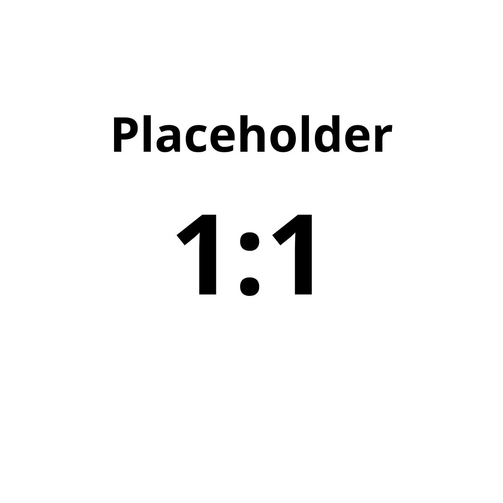

# Placeholder

Kumpulan gambar **placeholder** dengan berbagai rasio aspek untuk membantu proses pengembangan website. Gunakan gambar ini sementara sebelum foto produk, banner, thumbnail, video, atau aset final tersedia.

Repository: https://github.com/dddin97/Placeholder

## Daftar rasio

Semua gambar menggunakan format JPG.

| File | Rasio | Dimensi | Contoh penggunaan |
|---|---:|---:|---|
| `1-1.jpg` | 1:1 | 1200 × 1200 | Foto produk persegi, avatar, logo berbentuk persegi |
| `1.91-1.jpg` | 1.91:1 | 1200 × 628 | Gambar pratinjau tautan dan materi promosi |
| `16-10.jpg` | 16:10 | 1920 × 1200 | Gambar artikel dan konten landscape |
| `16-9.jpg` | 16:9 | 1920 × 1080 | Video, thumbnail, hero, media landscape |
| `17-9.jpg` | 17:9 | 2040 × 1080 | Media layar lebar |
| `2-1.jpg` | 2:1 | 1800 × 900 | Banner lebar dan kartu konten |
| `2-3.jpg` | 2:3 | 1200 × 1800 | Foto fashion/editorial portrait |
| `2-5.jpg` | 2:5 | 800 × 2000 | Panel visual vertikal tinggi |
| `21-9.jpg` | 21:9 | 2100 × 900 | Hero cinematic dan visual ultrawide |
| `3-1.jpg` | 3:1 | 1800 × 600 | Banner promosi horizontal |
| `3-2.jpg` | 3:2 | 1800 × 1200 | Foto workshop, dokumentasi, portofolio |
| `3-4.jpg` | 3:4 | 1200 × 1600 | Foto pakaian dan foto portrait |
| `3-5.jpg` | 3:5 | 900 × 1500 | Banner atau panel portrait tinggi |
| `4-1.jpg` | 4:1 | 1600 × 400 | Logo horizontal atau strip banner |
| `4-3.jpg` | 4:3 | 1600 × 1200 | Foto produk, dokumentasi, gambar umum |
| `4-5.jpg` | 4:5 | 1080 × 1350 | Poster dan materi promosi portrait |
| `5-3.jpg` | 5:3 | 1500 × 900 | Kartu foto landscape |
| `5-4.jpg` | 5:4 | 1500 × 1200 | Kartu foto horizontal |
| `8-1.jpg` | 8:1 | 1600 × 200 | Announcement bar atau strip informasi |
| `9-16.jpg` | 9:16 | 1080 × 1920 | Video vertikal dan konten mobile |

> Rasio menunjukkan perbandingan lebar terhadap tinggi, bukan ukuran wajib untuk semua gambar. Sesuaikan ukuran tampilan dengan layout dan kebutuhan performa website.

## Cara menggunakan

### 1. HTML

Letakkan gambar di folder proyek, lalu gunakan path relatif:

```html

```

Jika file disimpan dalam folder `assets/placeholders/`, sesuaikan path:

```html

```

### 2. CSS

Gunakan `aspect-ratio` untuk menentukan bentuk area media. Properti ini juga memungkinkan satu gambar dipakai dalam container responsif.

```css
.media-placeholder {
  display: block;
  width: 100%;
  aspect-ratio: 4 / 3;
  object-fit: cover;
  object-position: center;
}
```

Contoh rasio lain:

```css
/* Banner lebar */
.banner {
  aspect-ratio: 3 / 1;
}

/* Video landscape */
.video-thumbnail {
  aspect-ratio: 16 / 9;
}

/* Foto pakaian portrait */
.product-portrait {
  aspect-ratio: 3 / 4;
}

/* Video vertikal */
.short-video {
  aspect-ratio: 9 / 16;
}
```

### 3. React

```jsx
export default function ProductCard() {
  return (
    
  );
}
```

Untuk contoh React tersebut, simpan file di `public/placeholders/1-1.jpg`. Path `/placeholders/1-1.jpg` mengacu pada folder `public`.

## Memilih rasio yang tepat

- **Produk persegi:** `1-1.jpg`
- **Foto produk atau dokumentasi landscape:** `4-3.jpg` atau `3-2.jpg`
- **Banner promosi:** `3-1.jpg` atau `2-1.jpg`
- **Hero atau video landscape:** `16-9.jpg`
- **Foto pakaian portrait:** `3-4.jpg` atau `4-5.jpg`
- **Konten vertikal/mobile:** `9-16.jpg`
- **Strip informasi yang sangat lebar:** `8-1.jpg`

## `object-fit`: `cover` atau `contain`?

- `object-fit: cover` mengisi seluruh area, tetapi sebagian gambar bisa terpotong. Cocok untuk kartu produk, galeri, dan thumbnail.
- `object-fit: contain` menampilkan seluruh gambar, tetapi bisa menyisakan ruang kosong. Cocok untuk logo, ikon, dan gambar yang tidak boleh terpotong.
- Hindari memaksakan ukuran lebar dan tinggi tanpa rasio atau aturan fit yang sesuai karena gambar dapat terlihat terdistorsi.

## Menggunakan gambar dari GitHub

Untuk penggunaan dalam proyek, cara yang paling andal adalah mengunduh atau menyalin gambar ke folder aset proyek. Jika ingin menautkan gambar langsung dari GitHub, gunakan URL **raw** untuk file yang tepat; jangan menganggap URL halaman pratinjau GitHub sebagai URL gambar langsung.

## Kontribusi

Kontribusi dipersilakan. Untuk mengusulkan rasio atau format baru:

1. Jelaskan kegunaan placeholder yang diusulkan.
2. Sertakan rasio aspek dan dimensi piksel.
3. Gunakan nama file yang konsisten, misalnya `16-9.jpg`.
4. Pastikan gambar dapat dibuka dan sesuai dengan rasio yang didokumentasikan.
5. Ajukan perubahan melalui Pull Request.

## Lisensi dan penggunaan publik

Repository ini dapat dilihat publik di GitHub, tetapi **status publik tidak otomatis berarti gambar bebas digunakan tanpa syarat**. Periksa apakah repository telah memiliki file `LICENSE`. Jika pemilik ingin mengizinkan penggunaan, modifikasi, dan distribusi secara luas, pemilik dapat memilih lisensi yang sesuai—misalnya MIT untuk materi yang memang ingin dirilis dengan ketentuan tersebut—lalu menambahkan file lisensinya. Jangan menganggap MIT berlaku sebelum file lisensi itu benar-benar ditambahkan.

---

Dibuat untuk membantu developer menggunakan placeholder dengan rasio yang konsisten selama proses desain dan pengembangan website.
